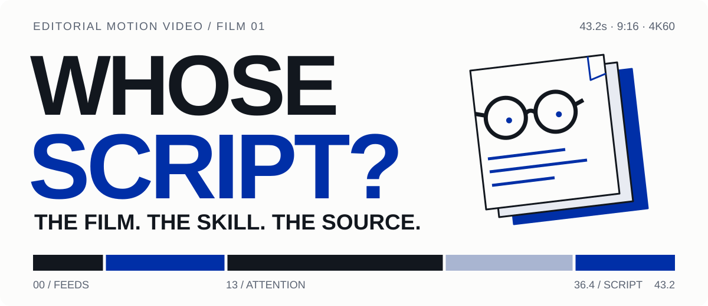
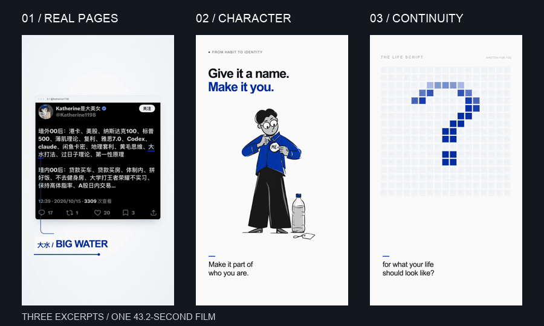
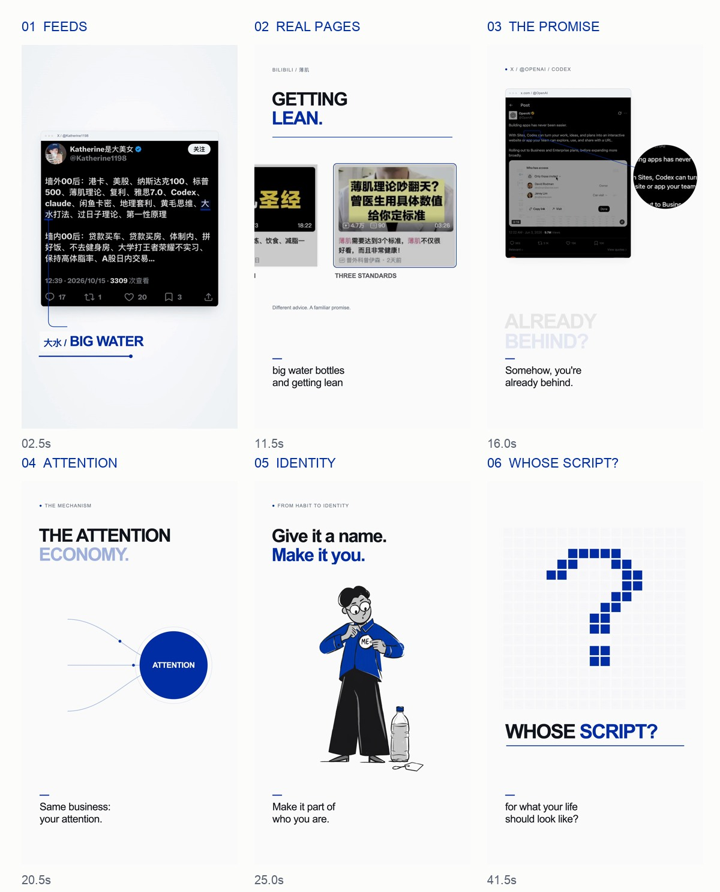

<p align="center">
  
</p>

<p align="center">
  
</p>

<p align="center">
  <a href="https://github.com/Lee-study154/editorial-motion-video/releases/tag/v1.0.0"><b>观看全片 · 4K60 / 1080p60</b></a>
  &nbsp;·&nbsp; <a href="./skills/editorial-motion-video/SKILL.md">The skill</a>
  &nbsp;·&nbsp; <a href="./skills/editorial-motion-video/assets/attention-example.zip">The source · ZIP</a>
</p>

**WHOSE SCRIPT?** 是一支关于注意力经济的 **43.2 秒、9:16** 短片：真实社媒页面、3D 运镜、蓝色插画人物与文字演示，配合英语 Thomas 旁白、原创电子配乐和音效。上方动图是同一成片不同片段的并列节选；完整作品提供 **2160 × 3840 / 60 fps** 母版。

本仓库同时提供制作它的 **editorial-motion-video** skill：可换内容的 starter、已验收的完整旧片示例，以及从分镜、静帧到声画审核和导出的流程。

<p align="center">
  
</p>

## How it works

- **真实页面承担信息。** 平台截图通过弹入、页面倾斜、汇聚与局部放大推进内容；代码还原的页面不能声称是运行实录。
- **插画承担观点。** 原片蓝色人物拆成局部图层，眼神、头部与手臂动作参与叙事。插画比例按新项目配置。
- **动效跟着语义走。** TalkCraft 主导解释片编排；OneTake 的公开运动原语与 clearing 案例启发了连续跨尺度结尾。Remotion 执行本工程的代码合成与渲染。
- **声音先预览，再升规格。** 英语旁白、原创程序配乐和轻音效完成混音；先看静帧和低规格声画，通过后再导出 4K60。配乐源码随示例附带。

Fred 视效库用于视觉参考；会员源码未包含。ShotCraft 是可选镜头参考，未安装或打包。这里没有接入完整 TalkCraft 工作台、OneTake 原生 HTML 渲染管线或所有官方案例。详见[来源与接入边界](./skills/editorial-motion-video/references/sources-and-boundaries.md)。

## Use it

**安装 skill。** 需要 Python 3、Node.js、已安装的 Chrome/Chromium；出片需要 FFmpeg。工程首次安装会下载 Remotion、React 等依赖，skill 不自动下载浏览器、模型或调用付费 API。

```bash
python3 "${CODEX_HOME:-$HOME/.codex}/skills/.system/skill-installer/scripts/install-skill-from-github.py" \
  --repo Lee-study154/editorial-motion-video \
  --ref codex/initial-release \
  --path skills/editorial-motion-video
```

新一轮对话调用 `$editorial-motion-video`，例如：

> 用 $editorial-motion-video 做一支 30 秒的产品宣传片。先给我动效选项和静帧，再出声画预览。

**创建新工程。** 编辑 `project.json` 的标题、镜头时长、横竖屏、帧率、素材与音轨；`public/` 存素材，`src/` 存确定性动效。

```bash
SKILL_DIR="${CODEX_HOME:-$HOME/.codex}/skills/editorial-motion-video"
python3 "$SKILL_DIR/scripts/init_project.py" ./my-film
cd my-film
npm install
python3 "$SKILL_DIR/scripts/doctor.py" .
npm run still
npm run render
```

浏览器不在默认位置时设置 `CHROME_PATH`；已有匹配依赖可设置 `EDITORIAL_NODE_MODULES` 复用。其他 agent 可读取 `SKILL.md`，需按其技能发现规则配置。

<details>
<summary>复现已完成的 43.2 秒作品</summary>

```bash
SKILL_DIR="${CODEX_HOME:-$HOME/.codex}/skills/editorial-motion-video"
python3 "$SKILL_DIR/scripts/init_project.py" ./attention-example --example
cd attention-example
npm ci
node render.mjs --still --frame 2406 --out out/ending.png
node render.mjs --out out/film.mp4
```

示例包含实际组件、素材、最终混音、原创配乐源码与渲染入口。普通渲染保留原片时序与混音；原 4K60 母版的结尾多曝光快门另有较重的入口，见[复现说明](./skills/editorial-motion-video/references/reproduce-example.md)。跨系统不承诺逐像素一致。

</details>

```text
skills/editorial-motion-video/       可安装的 skill、配置起点和渲染工具
  assets/attention-example.zip       旧片源码、素材、混音、配乐源码与来源记录
  assets/starter/                    可换内容的新工程起点
assets/readme/                       专属首图、真实片段动图与六帧总览
scripts/generate_readme_assets.py     从成片生成 README 展示素材
```

可编辑工作台、动效拆分入库与自动歌曲生成尚未实现。

## Cover

<p align="center">
  <a href="https://github.com/Lee-study154/editorial-motion-video/releases/download/v1.0.0/attention-economy-cover-2160x3840.png"></a>
</p>

封面复用原片已确认的蓝色插画。[2160 × 3840 高清图](https://github.com/Lee-study154/editorial-motion-video/releases/download/v1.0.0/attention-economy-cover-2160x3840.png) · [1080 × 1920 发布图](https://github.com/Lee-study154/editorial-motion-video/releases/download/v1.0.0/attention-economy-cover-1080x1920.png)

## Sources & license

这是个人学习与制作项目。TalkCraft 与 OneTake 的相关源码和改编受 **PolyForm Noncommercial 1.0.0** 约束；项目没有将第三方内容统一改为 MIT。截图、配音与插画保留各自权利，见 [NOTICE](./NOTICE.md) 与[完整上游许可](./licenses/)。

来源：[TalkCraft](https://github.com/Vincentwei1021/video-talkcraft) · [OneTake](https://github.com/feitangyuan/onetake) · [Fred 视效库](https://www.fred-fu.com/visual-library) · [蓝色插画 skill](https://github.com/Lee-study154/blue-editorial-illustrations) · [ShotCraft](https://github.com/Vincentwei1021/video-shotcraft)。
