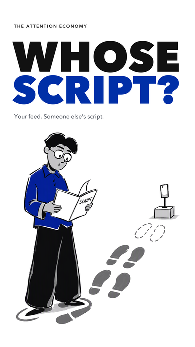

# Editorial Motion Video

**用 agent 制作有真实页面、插画、配音和动效的短片。**

从分镜、静帧预览到声画审核与导出，把已经完成的一支片子整理成可安装的 skill、可换内容的起点和可复现的源码示例。

[观看成片](https://github.com/Lee-study154/editorial-motion-video/releases/download/v1.0.0/attention-economy-preview.mp4) · [下载 4K60 母版](https://github.com/Lee-study154/editorial-motion-video/releases/download/v1.0.0/attention-economy-4k60.mp4) · [获取 skill](https://github.com/Lee-study154/editorial-motion-video/releases/tag/v1.0.0)

## 已完成作品：Whose Script?

<p align="center">
  <a href="https://github.com/Lee-study154/editorial-motion-video/releases/download/v1.0.0/attention-economy-preview.mp4"></a>
</p>

**43.2 秒 · 9:16 · 英语 Thomas 旁白 · 原创电子配乐 · 2160 × 3840 / 60 fps**

围绕注意力经济，用真实社媒页面、3D 页面运镜、蓝色插画人物动作和文字演示推进叙事。结尾以连续跨尺度运镜收束到 “WHOSE SCRIPT?”。

[1080p60 预览](https://github.com/Lee-study154/editorial-motion-video/releases/download/v1.0.0/attention-economy-preview.mp4) · [高清封面](https://github.com/Lee-study154/editorial-motion-video/releases/download/v1.0.0/attention-economy-cover-2160x3840.png) · [全部发布附件](https://github.com/Lee-study154/editorial-motion-video/releases/tag/v1.0.0)

## 包含什么

- **可安装的 skill**：制作顺序、镜头选择、静帧检查、声画审核与交付规范。
- **可换内容的 starter**：用 `project.json` 配置横竖屏、帧率、标题、镜头时长、素材与音轨；预置文字入场、页面 3D 和插画浮动。
- **完整旧片示例**：已验收组件、实际素材、最终混音、原创配乐源码与 4K60 渲染入口。

制作顺序：**内容与分镜 → 静帧确认 → 低规格声画预览 → 审核后升规格导出**。

## 安装与第一次使用

需要 Python 3、Node.js、已安装的 Chrome/Chromium。出片需要 FFmpeg；首次安装视频工程依赖会下载 Remotion、React 等包，skill 不自动下载浏览器、模型或调用付费 API。

在 Codex 中使用内置 skill-installer：

```bash
python3 "${CODEX_HOME:-$HOME/.codex}/skills/.system/skill-installer/scripts/install-skill-from-github.py" \
  --repo Lee-study154/editorial-motion-video \
  --ref codex/initial-release \
  --path skills/editorial-motion-video
```

新一轮对话调用 `$editorial-motion-video`，例如：

> 用 $editorial-motion-video 做一支 30 秒的产品宣传片。先给我动效选项和静帧，再出声画预览。

也可以直接创建工程：

```bash
SKILL_DIR="${CODEX_HOME:-$HOME/.codex}/skills/editorial-motion-video"
python3 "$SKILL_DIR/scripts/init_project.py" ./my-film
cd my-film
npm install
python3 "$SKILL_DIR/scripts/doctor.py" .
npm run still
```

编辑 `project.json` 与 `public/` 素材后，运行 `npm run render`。浏览器不在默认位置时设置 `CHROME_PATH`。已有匹配依赖可设置 `EDITORIAL_NODE_MODULES` 复用；其他 agent 可读取 `SKILL.md`，需按各自的技能发现规则配置。

<details>
<summary>复现本仓库已完成的 43.2 秒作品</summary>

```bash
SKILL_DIR="${CODEX_HOME:-$HOME/.codex}/skills/editorial-motion-video"
python3 "$SKILL_DIR/scripts/init_project.py" ./attention-example --example
cd attention-example
npm ci
node render.mjs --still --frame 2406 --out out/ending.png
node render.mjs --out out/film.mp4
```

普通渲染保留原片时序与最终混音；原 4K60 母版的结尾多曝光快门另有较重的渲染入口，见[复现说明](./skills/editorial-motion-video/references/reproduce-example.md)。跨系统不承诺逐像素一致。

</details>

## Skill 与动效分别负责什么

| 来源 | 在本项目中的职责 | 实际接入范围 |
| --- | --- | --- |
| [TalkCraft](https://github.com/Vincentwei1021/video-talkcraft) | 解释片分镜与画面编排 | 页面弹入、3D 页面、汇聚、放大与文字组件的改编 |
| [OneTake](https://github.com/feitangyuan/onetake) | 动作连续性、运镜与案例参考 | 旧片 clearing 风格结尾与公开运动原语的改编 |
| [Fred 视效库](https://www.fred-fu.com/visual-library) | 视觉选型参考 | 未包含会员源码或整库接口 |
| [蓝色插画 skill](https://github.com/Lee-study154/blue-editorial-illustrations) | 人物与插画资产 | 旧片已确认插画；新项目可选的独立 skill |
| Remotion | 本工程实际渲染 | 页面、文字、人物与音轨的代码合成及导出 |

[ShotCraft](https://github.com/Vincentwei1021/video-shotcraft) 可作为新项目的镜头参考；本仓库未安装或打包它。OneTake 案例是效果选项目录，不代表每个案例完整源码都公开。本包也没有接入完整 TalkCraft 工作台或 OneTake 原生 HTML 渲染管线。

## 当前边界与来源

这是个人学习与制作项目。可编辑工作台、案例动效拆分入库、自动歌曲生成等功能尚未实现。插画比例按项目配置；真实界面需核实来源，代码还原的页面不能声称是运行实录。

TalkCraft 与 OneTake 的相关源码和改编受 **PolyForm Noncommercial 1.0.0** 约束；项目不将第三方内容统一改为 MIT。截图、配音与插画保留各自权利，详见 [NOTICE](./NOTICE.md)、[完整上游许可](./licenses/) 与[来源及接入边界](./skills/editorial-motion-video/references/sources-and-boundaries.md)。依赖软件遵循各自许可。
